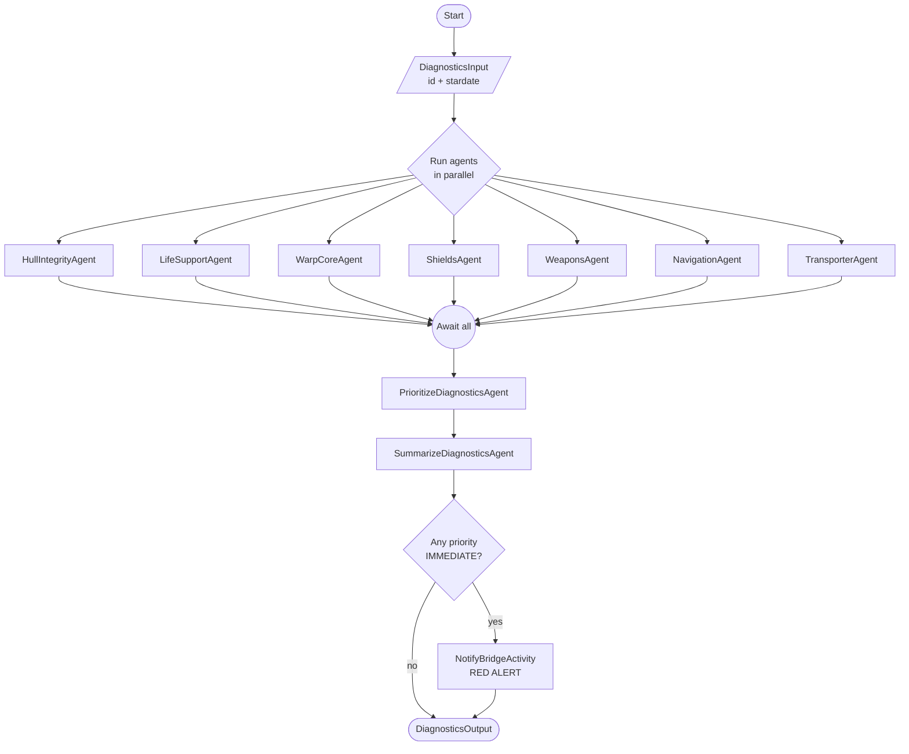

# EnterpriseDiagnostics - Durable MAF Agents with Catalyst

This repo contains an agentic application that runs a full diagnostic sweep on the U.S.S. Enterprise. The application runs seven independent LLM-driven analyses in parallel — hull integrity, life support, warp core, shields, weapons, navigation, and transporter — has a prioritization agent rank the systems and assign actions, composes a deterministic summary, and (when any system is flagged for `IMMEDIATE` action) dispatches a bridge-notification activity to acknowledge the alert.

## Contents

- `EnterpriseDiagnostics.AppHost` — Aspire AppHost that runs the ApiService against either **Diagrid Catalyst** or a **locally installed Dapr** (selected with the `USE_CATALYST` environment variable), and forwards `OPENAI_API_KEY` to the service.
- `EnterpriseDiagnostics.ApiService` — ASP.NET Core service that hosts the diagnostics workflow, the nine agents, and the HTTP endpoints used to start and observe runs.
- `EnterpriseDiagnostics.ServiceDefaults` — Aspire shared project providing OpenTelemetry, health checks, service discovery, and resilience defaults.

## Architecture

The solution is built on:

- **.NET 10 / ASP.NET Core** — host for the workflow service.
- **.NET Aspire** — orchestrates the local development topology (AppHost + ServiceDefaults).
- **Dapr / Diagrid Catalyst** — the workflow runtime. Locally installed Dapr (sidecar started by the AppHost, with Valkey as the state store) or Diagrid Catalyst (managed workflow runtime, provisioned by the AppHost via `AddCatalystProject(...)` with `EnableManagedWorkflow = true`).
- **Microsoft Agent Framework** (`Microsoft.Agents.AI`) — the `ChatClientAgent` abstraction used for each diagnostic role.
- **Diagrid.AI.Microsoft.AgentFramework** — Diagrid integration that runs each agent invocation as a Dapr Workflow activity, so agent calls are checkpointed and replay-safe.
- **OpenAI** (`gpt-4o-mini`) — chat backend for the agents, accessed via `Microsoft.Extensions.AI.OpenAI`.

### Running modes

The AppHost supports two modes, selected by the `USE_CATALYST` environment variable:

| | Local Dapr (default) | Diagrid Catalyst |
|---|---|---|
| Selected by | `USE_CATALYST` unset, or any value other than `true` | `USE_CATALYST=true` |
| Workflow runtime | Dapr sidecar from your local Dapr install | Managed Catalyst project `aspire-maf` |
| Workflow state | Valkey container (`workflow-store` in `Resources/state.yaml`) | Catalyst managed state store |
| Agent registry | `agent-registry` component on the same Valkey | `agent-registry` managed connection (created by `diagrid agent create`) |
| Inspect runs with | [Diagrid Dapr Dev Dashboard](https://github.com/diagridio/dev-dashboard) (started by the AppHost, http://localhost:9090) | Catalyst console |

### Prerequisites

Required for both modes:

- [.NET 10 SDK](https://dotnet.microsoft.com/en-us/download)
- [Aspire CLI](https://aspire.dev/get-started/install-cli/)
- [Docker](https://www.docker.com/products/docker-desktop/) or [Podman](https://podman.io/docs/installation) (Valkey runs as a container in local Dapr mode)
- An OpenAI API key, exported as `OPENAI_API_KEY` in the shell that launches the AppHost

Additionally for **local Dapr** mode:

- [Dapr CLI](https://docs.dapr.io/getting-started/install-dapr-cli/), initialized with `dapr init` (provides the Dapr runtime, placement and scheduler services)
- Optional: the [Diagrid Dapr Dev Dashboard](https://github.com/diagridio/dev-dashboard) (`diagrid-dev-dashboard`). If it is not installed, only the `dapr-dev-dashboard` resource fails to start; the app still runs.

  ```shell
  # macOS / Linux
  curl -sSL https://raw.githubusercontent.com/diagridio/dev-dashboard/main/scripts/install.sh | sh
  ```

  ```powershell
  # Windows (PowerShell)
  iwr -useb https://raw.githubusercontent.com/diagridio/dev-dashboard/main/scripts/install.ps1 | iex
  ```

Additionally for **Catalyst** mode:

- [Diagrid CLI](https://docs.diagrid.io/catalyst/references/cli-reference/install-diagrid-cli)
- A [Diagrid Catalyst](https://www.diagrid.io/catalyst) account, signed in via `diagrid login`

In local Dapr mode the AppHost manages Valkey as a container, so do not run Redis or Valkey yourself. In Catalyst mode workflow state is hosted by Diagrid Catalyst and no local state store or Dapr sidecar is needed.

## Workflow



Each agent returns strict JSON that is deserialized — via a source-generated `JsonSerializerContext` — into a typed `record` (`HullIntegrityResult`, `LifeSupportResult`, `WarpCoreResult`, `ShieldsResult`, `WeaponsResult`, `NavigationResult`, `TransporterResult`, `PrioritizationResult`, `DiagnosticsSummaryResult`). After all seven diagnostics complete, the `PrioritizeDiagnosticsAgent` ranks them 1–7 and assigns each an action (`IMMEDIATE`, `SCHEDULED`, `MONITOR`, `NONE`); the `SummarizeDiagnosticsAgent` then produces the final summary. Branching on `action == "IMMEDIATE"` is performed deterministically inside the workflow so it stays replay-safe; the bridge notification is dispatched as a `NotifyBridgeActivity` (a workflow activity, not an agent).

## Run the application

Choose a mode: [local Dapr](#option-a-local-dapr) or [Diagrid Catalyst](#option-b-diagrid-catalyst). In both cases, first set the OpenAI key in the shell that will launch Aspire:

```shell
export OPENAI_API_KEY=sk-...    # Linux/macOS
$env:OPENAI_API_KEY="sk-..."    # Windows PowerShell
```

### Option A: local Dapr

Make sure Dapr is initialized (`dapr init`) and Docker is running, then start the AppHost from the `EnterpriseDiagnosticsMAF` folder:

```shell
aspire run
```

The AppHost then:

- Starts a **Valkey** container (port 16379) used as the state store for workflow state, configured in `EnterpriseDiagnostics.AppHost/Resources/state.yaml` (`workflow-store`, plus `agent-registry` for the agent metadata).
- Starts the **ApiService** (`maf-app`) with a Dapr sidecar that loads the components from `Resources/`, and waits for Valkey to be ready.
- Starts the **Diagrid Dapr Dev Dashboard** as the `dapr-dev-dashboard` resource (http://localhost:9090) to inspect workflow instances, their history, and sidecar logs.

### Option B: Diagrid Catalyst

1. Select Catalyst mode in the shell that will launch Aspire:

  ```shell
  export USE_CATALYST=true        # Linux/macOS
  $env:USE_CATALYST="true"        # Windows PowerShell
  ```

2. Login into Diagrid Catalyst, and follow the instructions:

  ```shell
  diagrid login
  ```

3. Create the Catalyst project and register `maf-app` as an **Agent**:

  ```shell
  diagrid project create aspire-maf --enable-managed-workflow --deploy-managed-kv --wait --use
  diagrid agent create maf-app --wait
  ```

> This step is required and cannot be done from the AppHost: `Diagrid.Aspire.Hosting.Catalyst`
> only creates plain App IDs (`diagrid appid create`), and the agent registry files each agent
> under an App ID that is backed by an Agent. Create the project first so the AppHost attaches
> to the existing one instead of racing to create `maf-app` as a plain App ID.
>
> `diagrid agent create` also provisions the `agent-registry` state store the ApiService writes
> agent metadata to. It is a managed connection, so it does not appear in `diagrid component list`
> — and the AppHost must not try to create it, because the integration has no `--ignore-if-exists`
> and fails provisioning outright with "Resource already exists".
>
> `--deploy-managed-kv` is required here too, and cannot be deferred to the AppHost.
> `AddCatalystProject` always issues a `diagrid project create` (there is no existence check —
> reuse of an existing project relies on the CLI not treating a repeat create as an error), and it
> hardcodes `--deploy-managed-kv=false --deploy-managed-pubsub=false`. `EnableManagedWorkflow` is
> the only project setting the AppHost can influence, so a project first created by `aspire run`
> has no key/value store at all.

4. Start the Aspire application from the `EnterpriseDiagnosticsMAF` folder:

  ```shell
  aspire run
  ```

> The AppHost fails fast at startup if `OPENAI_API_KEY` is missing (in both modes).

With `USE_CATALYST=true` the AppHost:

- Attaches to (or provisions) the **Diagrid Catalyst** project (`aspire-maf`) with a managed workflow state store.
- Starts the **ApiService** (`maf-app`) wired to that Catalyst project, with `OPENAI_API_KEY` forwarded into its environment.

Navigate to the Aspire dashboard (in either mode), open the Resources page, and click on the Catalyst Dashboard link. Open the `aspire-maf` project via the *Projects* item in the left menu, then select the [Workflows item](https://catalyst.diagrid.io/workflows/executions) under *Operate* in the left menu. Once you've started a workflow with the `start` endpoint you can view the workflow state here.

## Endpoints

The ApiService exposes these endpoints (see `EnterpriseDiagnostics.ApiService/Program.cs`):

| Method | Path                       | Purpose                                  |
|--------|----------------------------|------------------------------------------|
| POST   | `/start`                   | Schedule a new diagnostics workflow      |
| GET    | `/status/{instanceId}`     | Read the current state and output        |
| POST   | `/pause/{instanceId}`      | Suspend a running workflow               |
| POST   | `/resume/{instanceId}`     | Resume a suspended workflow              |
| POST   | `/terminate/{instanceId}`  | Terminate a workflow instance            |

Replace `5407` with the actual ApiService port shown in the Aspire dashboard.

### Start a diagnostics workflow

Linux/macOS (curl):

```shell
curl -X POST http://localhost:5407/start \
  -H "Content-Type: application/json" \
  -d '{"id":"diag-001","stardate":"47988.1"}'
```

Windows (PowerShell):

```powershell
Invoke-RestMethod -Method Post -Uri http://localhost:5407/start `
  -ContentType "application/json" `
  -Body '{"id":"diag-001","stardate":"47988.1"}'
```

### Get the workflow status

Linux/macOS (curl):

```shell
curl http://localhost:5407/status/diag-001
```

Windows (PowerShell):

```powershell
Invoke-RestMethod -Uri http://localhost:5407/status/diag-001
```

### Pause / resume / terminate

Linux/macOS (curl):

```shell
curl -X POST http://localhost:5407/pause/diag-001
curl -X POST http://localhost:5407/resume/diag-001
curl -X POST http://localhost:5407/terminate/diag-001
```

Windows (PowerShell):

```powershell
Invoke-RestMethod -Method Post -Uri http://localhost:5407/pause/diag-001
Invoke-RestMethod -Method Post -Uri http://localhost:5407/resume/diag-001
Invoke-RestMethod -Method Post -Uri http://localhost:5407/terminate/diag-001
```

You can also drive these requests from [`EnterpriseDiagnostics.ApiService/EnterpriseDiagnostics.ApiService.http`](EnterpriseDiagnosticsMAF/EnterpriseDiagnostics.ApiService/EnterpriseDiagnostics.ApiService.http) using the VS Code REST Client or JetBrains HTTP Client.

## Inspecting workflow execution

In **local Dapr** mode, open the **Diagrid Dapr Dev Dashboard** at http://localhost:9090 (the `dapr-dev-dashboard` resource in the Aspire dashboard) to browse workflow instances, their execution history and sidecar logs.

In **Catalyst** mode, workflow instances run against the managed state store in your Diagrid Catalyst project. To inspect them, open the **Diagrid Catalyst console** and navigate to the `aspire-maf` project — you can browse workflow instances, view orchestration history, inspect every agent (LLM) call as a workflow activity with its inputs and outputs, and watch state transitions in real time.
